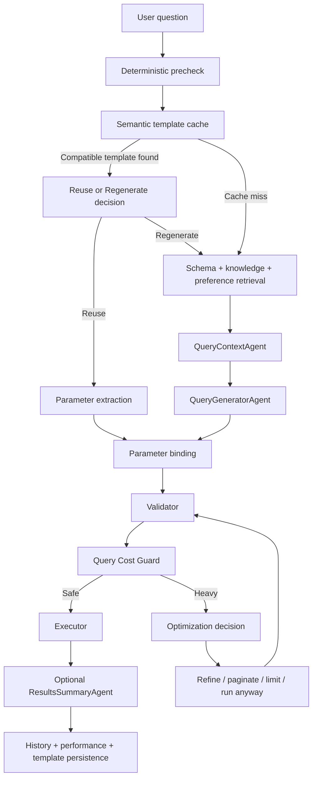

# Data Pilot

Ask questions about a MongoDB database in plain language and receive validated, read-only query results with a concise answer. This project combines a FastAPI backend, an Angular interface, PyMongo execution, and a direct multi-agent workflow using OpenAI. It does not use LangGraph.


The backend discovers collections and fields, retrieves relevant schema metadata, generates a structured query, validates its structure, estimates its cost, and executes it. Feedback can teach preferences or database rules. Successful queries become reusable templates only after explicit positive feedback, with an explicit choice to reuse or regenerate later.


## Status

**Stage:** Internal MVP / active development

Data Pilot is an internal AI-assisted MongoDB interrogation platform. It is functional and actively evolving, but it should not yet be treated as a fully hardened multi-tenant production system. Generated interpretations and queries should still be reviewed for business-critical use.

## Quick Start

For a local backend setup:

```bash
git clone <repository-url>
cd mongo-db-interrogator
python -m venv .venv
```

Install dependencies:

```bash
# Windows
.\.venv\Scripts\python.exe -m pip install -r requirements.txt

# Linux/macOS
source .venv/bin/activate
python -m pip install -r requirements.txt
```

Create `.env` from `.env.example` and configure at minimum:

```dotenv
MONGODB_URI=mongodb://localhost:27017
MONGODB_DATABASE=your_database
OPENAI_API_KEY=your-openai-api-key
```

Start the backend:

```bash
python -m uvicorn main_api:app --reload
```

Then open:

- `http://localhost:8000/docs` for Swagger
- `http://localhost:8000/health` for health/schema status
- `http://localhost:4200/` for the separately started frontend

Swagger (`/docs`), ReDoc (`/redoc`), and `/openapi.json` require browser HTTP Basic login for testing: username `billcom`, password `billcom`. This documentation login is separate from the existing API key protection for query/feedback endpoints.

MongoDB 4.4 compatibility: template, query-history, schema-cache, and pending optimization payloads containing dollar-prefixed or dotted keys are stored in a reversible Extended JSON envelope. Searchable metadata remains native, and repository reads restore the original query/schema structures. Older native records remain readable; failed template saves can be recreated by liking a subsequent successful query. Optimization and pagination restore their stored queries before execution; this applies to both legacy native records and encoded records.

Active database knowledge restores its referenced collections and fields from the full schema catalog before collection selection, even if schema retrieval omitted them. A saved correction can therefore select its verified source collection instead of being restricted to an incorrect history/log candidate. Restart after prompt changes because prompts are cached in process.

For the full setup, frontend build, Docker usage, and configuration details, continue with the sections below.

## Contents

- [Status](#status)
- [Quick Start](#quick-start)
- [Features](#features)
- [Requirements](#requirements)
- [Local installation](#local-installation)
- [Docker installation](#docker-installation)
- [Using the web interface](#using-the-web-interface)
- [API reference](#api-reference)
- [Architecture and workflows](#architecture-and-workflows)
- [Configuration reference](#configuration-reference)
- [Security](#security)
- [Storage, privacy, and access](#storage-privacy-and-access)
- [Project structure](#project-structure)
- [Development and testing](#development-and-testing)
- [Git workflow](#git-workflow)
- [Troubleshooting](#troubleshooting)
- [Current limitations](#current-limitations)
- [Maintainers](#maintainers)
- [License](#license)

## Features


\| Feature | Behavior |

\| --- | --- |

\| Natural-language interrogation | Convert questions into structured MongoDB query specifications. |

\| Read-only queries | Support find, aggregation, document counts, and distinct values. |

\| Schema discovery | Infer field paths/types, including nested documents and sampled arrays. |

\| Semantic schema retrieval | Rank metadata through embeddings, lexical matches, aliases, and relationship candidates. |

\| Persistent schema cache | Reuse metadata/vectors across restarts and update changed entries incrementally. |

\| Validation and repair | Validate before execution and allow at most one repair for eligible failures. |

\| Parameterized queries | Separate reusable structure from typed parameter values and bind before validation. |

\| Cost guard | Pause potentially expensive queries and offer explicit optimization choices. |

\| Refinement and pagination | Continue retained query context or fetch result pages from the backend. |

\| Performance memory | Record structural statistics and common optimization choices. |

\| Semantic template cache | Suggest compatible successful templates with positive feedback; reuse requires a user decision. |

\| Feedback learning | Classify corrections into user preferences, database knowledge, or one-off feedback. |

\| Knowledge retrieval | Supply active learned business rules separately from technical schema. |

\| Live progress | Stream actual workflow stage transitions through Server-Sent Events (SSE). |

\| Angular UI | Show tables, scalar results, nested record details, queries, summaries, feedback, and continuation controls. |

\| Observability | Return usage/timing/cache metrics and operational traces; optionally export traces and token logs. |

\| Docker | Separate backend and frontend images with Compose, API proxying, and health checks. |


Example questions, provided the corresponding collections and fields exist:


\- "Show the latest 10 orders."

\- "Count customers from Tunisia."

\- "List the distinct order statuses."

\- "Show the top 5 customers by completed-order revenue."

\- "Give me the orders of command CMD-000009350132."


Use explicit metrics, fields, filters, dates, and ordering when business meaning could be ambiguous. The repository does not provide a business dataset.


## Requirements


For local backend installation:


\- Python 3.12 is the recommended baseline and the version used by Docker.

\- An accessible MongoDB database containing your business collections.

\- MongoDB 4.2+ for performance-memory update pipelines; the server must also support the aggregation expressions your queries require.

\- An OpenAI API key and access to the configured chat and embedding models.

\- Network access to MongoDB/model services, and package registries during installation.


For the frontend, use Node.js/npm compatible with the pinned Angular 21.2 packages. Check package engine requirements when selecting Node. You can run the API without building the frontend.


For Docker, run Docker's Linux container engine. The separate frontend image compiles Angular; the backend image contains Python. MongoDB is configured externally.


## Local installation


Run backend commands from the repository root.


### 1. Install Python dependencies


Windows PowerShell:


```powershell

python -m venv .venv

.\\.venv\Scripts\python.exe -m pip install -r requirements.txt

```


Linux/macOS:


```bash

python3 -m venv .venv

source .venv/bin/activate

python -m pip install -r requirements.txt

```


Using the environment's Python directly on Windows avoids PowerShell activation-script restrictions.


### 2. Create and configure the environment file


Preserve existing settings. PowerShell:


```powershell

if (-not (Test-Path -LiteralPath .env)) {

  Copy-Item -LiteralPath .env.example -Destination .env

}

```


Linux/macOS:


```bash

test -f .env || cp .env.example .env

```


Edit .env and set:


```dotenv

MONGODB_URI=mongodb://localhost:27017

MONGODB_DATABASE=your_database

OPENAI_API_KEY=your-openai-api-key

OPENAI_MODEL=your-available-chat-model

SCHEMA_ENRICHMENT_MODEL=your-available-chat-model

SCHEMA_EMBEDDING_MODEL=text-embedding-3-small

KNOWLEDGE_EMBEDDING_MODEL=text-embedding-3-small

```


The repository's chat-model default is gpt-6.1-sol. This is a code setting, not a guarantee of access for your account; configure identifiers available to your deployment. Both embedding settings must match. The example explicitly sets the enrichment model, so update that too when changing the chat model.


.env.example uses host.docker.internal for Docker Desktop. Use localhost when backend and MongoDB run directly on the same machine. For remote MongoDB or Atlas, use your connection URI with appropriate authentication/TLS/network settings.


The database account needs business-data reads, collection discovery, and writes/index creation for internal application collections. A completely read-only account cannot persist schema caches, feedback, history, or learning.


Optional API protection:


```dotenv

API_KEY=your-shared-application-key

ALLOWED_ORIGINS=http\://127.0.0.1:4200,http\://localhost:4200

```


API_KEY is separate from OPENAI_API_KEY. An empty application key disables shared-key protection. ALLOWED_ORIGINS is a comma-separated CORS list; its default is \*.


### 3. Start the backend


Windows:


```powershell

.\\.venv\Scripts\python.exe -m uvicorn main_api:app --reload

```


Linux/macOS, with the environment activated:


```bash

python -m uvicorn main_api:app --reload

```


Regular server process without development reload:


```bash

python -m uvicorn main_api:app --host 0.0.0.0 --port 8000

```


Startup inspects MongoDB and loads/builds the schema index before Uvicorn finishes starting. First bootstrap can make enrichment and embedding calls. If bootstrap fails without a usable cached index, diagnostic endpoints remain available but queries are not ready.


\| URL | Purpose |

\| --- | --- |

\| http\://localhost:8000/ | API service information (the frontend runs separately). |

\| http\://localhost:8000/docs | Interactive Swagger documentation. |

\| http\://localhost:8000/redoc | Alternative API documentation. |

\| http\://localhost:8000/health | Database connectivity and schema status. |

\| http\://localhost:8000/ready | Readiness; HTTP 503 when database/schema is unavailable. |


### 4. Run the separate Angular frontend

The frontend repository is beside this backend, in `../data_pilot_frontend`. Its Angular project is inside `frontend/`:

```bash
cd ../data_pilot_frontend/frontend
npm ci
npm start
```

Open http://127.0.0.1:4200 and keep the backend running on port 8000. The development proxy forwards query, feedback, and health requests. Use `npm.cmd` on PowerShell if the npm script shim is blocked.

Run `npm run build` to compile production assets. The backend no longer serves Angular or reads a frontend folder. The frontend Docker image builds and serves Angular independently, preserving its `/static/` asset URLs.

`frontend/src/environments/environment.ts` in the frontend repository uses an empty `apiBaseUrl`: requests use the development proxy locally and Nginx in Docker. No API URL rebuild is needed for Docker. A separately hosted UI without this proxy needs a configured API URL and matching backend CORS settings.

## Docker installation

The backend and frontend each have their own Dockerfile and `compose.yaml`. Start the backend first to create the shared `data-pilot` network:

```bash
# From mongo-db-interrogator, with .env configured:
docker compose up -d --build

# In a second terminal, from the frontend repository:
cd ../data_pilot_frontend
docker compose up -d --build
```

Open http://localhost:4200 for Angular and http://localhost:8000/docs for the API. Both published ports bind to the local machine by default. Set `FRONTEND_PORT` or `BACKEND_PORT` in the respective Compose environment to change them.

The backend image contains Python only and runs as UID/GID 10001. The frontend uses a Node build stage and an Nginx runtime, proxies API requests to `http://backend:8000`, and disables buffering for SSE. Nginx resolves the backend through Docker DNS so backend container recreation is supported. `BACKEND_URL` can override the upstream at frontend startup; use a URL without a trailing slash or path prefix. Restart/recreate the frontend after changing it.

Configure backend `.env` with `OPENAI_API_KEY`, `MONGODB_DATABASE`, and `MONGODB_URI`. For MongoDB on the host, use `mongodb://host.docker.internal:27017`; Compose includes the host gateway mapping. MongoDB must listen on a reachable interface. No MongoDB server or business dataset is bundled; remote MongoDB/Atlas also works.

Artifacts persist in a named volume at `/app/data/artifacts`. Backend health checks require database connectivity and schema readiness. Frontend health checks test Nginx only; `/health` and `/ready` through the frontend report backend status.

```bash
# Run in either repository:
docker compose logs -f
docker compose down
```

Stop the frontend before stopping the backend because its shared network is external. `down` preserves the artifact volume. See [DOCKER.md](DOCKER.md) and the separate frontend README for build/run details.
## Using the web interface


1\. Wait for the readiness badge to report the database/schema available.

2\. Enter a question and click Ask or press Ctrl/Cmd + Enter.

3\. Follow actual stages/timings in Agent execution.

4\. If a template suggestion appears, choose Reuse template or Regenerate.

5\. If Large request detected appears, choose an offered optimization, provide refinement text, or explicitly Run anyway.

6\. Inspect tables/scalars and the summary. Use View query, structured-cell details, and View record to inspect the answer.

7\. Choose Yes for useful answers. Choose No, enter a correction, and submit feedback to regenerate.


For a protected API, open the frontend browser's developer console, set the application key for that tab, then reload:


```javascript

sessionStorage.setItem('mongo-api-key', 'your-shared-application-key');

```


Remove it with:


```javascript

sessionStorage.removeItem('mongo-api-key');

```


The UI sends X-API-Key. There is no login screen or bundled secret. Never place the OpenAI provider key in browser storage.


Positive feedback does not rerun the query or call feedback analysis. After negative feedback is saved, the UI reruns the exact original question. Its effect depends on classification and whether learning actually succeeded/activated. If regeneration fails, the previous answer remains and retry avoids duplicate feedback. The UI reports analysis errors separately.


## API reference


### Endpoints


\| Method | Path | Key required when configured | Purpose |

\| --- | --- | --- | --- |

\| GET | / | No | Frontend or API links. |

\| GET | /health | No | Diagnostics; degraded status can still have HTTP 200. |

\| GET | /ready | No | Readiness, with HTTP 503 when unavailable. |

\| GET | /docs, /redoc, /openapi.json | No | Documentation/specification. |

\| POST | /query | Yes | Ask a non-empty question. |

\| POST | /query/stream | Yes | Ask with SSE progress. |

\| POST | /query/{request_id}/template-decision | Yes | Reuse a template or regenerate. |

\| POST | /query/{request_id}/optimize | Yes | Continue a retained query. |

\| POST | /feedback | Yes | Store feedback and optionally analyze a correction. |


Protected requests use X-API-Key. An execution failure can appear in an HTTP 200 response with execution_success=false; inspect both HTTP status and body.


### Ask a question


PowerShell:


```powershell

$headers = @{ 'X-API-Key' = 'your-shared-application-key' }

$body = @{ question = 'Show the latest 10 orders' } | ConvertTo-Json

$answer = Invoke-RestMethod -Method Post -Uri 'http\://localhost:8000/query' -Headers $headers -ContentType 'application/json' -Body $body

$answer

```


Bash:


```bash

curl -X POST http\://localhost:8000/query \\

  -H 'Content-Type: application/json' \\

  -H 'X-API-Key: your-shared-application-key' \\

  -d '{"question":"Show the latest 10 orders"}'

```


Omit the key header if API_KEY is blank. An illustrative, abbreviated response:


```json

{

  "request_id": "req_example",

  "status": "completed",

  "execution_success": true,

  "execution_result": [{"order_id": "ORD-001", "status": "completed"}],

  "final_response": "Found 1 results.",

  "validated_query": {

    "operation": "find",

    "collection": "orders",

    "filter": {},

    "sort": [["\_id", -1]],

    "limit": 10,

    "skip": 0

  },

  "query_plan": null

}

```


Real IDs are server-generated req\_\<uuid> values. Responses can include query_context, schema_spec, generated templates/parameters, validated queries, validation errors, execution metadata/path/trace, applied preferences/knowledge, and telemetry. query_plan and python_artifact normally remain null for compatibility.


\| Response status | What to do |

\| --- | --- |

\| completed | Check execution_success and show results/error. |

\| similar_template_detected | Submit a decision using the returned request/template IDs. |

\| optimization_required | Display offered choices and submit a continuation. The business result query is paused. |


### Stream progress


```bash

curl -N -X POST http\://localhost:8000/query/stream \\

  -H 'Content-Type: application/json' \\

  -H 'X-API-Key: your-shared-application-key' \\

  -d '{"question":"Show the latest 10 orders"}'

```


This is POST SSE, not a GET EventSource endpoint. Frames carry JSON:


```text

event: workflow

data: {"agent":"ValidatorAgent","status":"completed","elapsed_ms":1.2}


event: result

data: {"request_id":"req_example","status":"completed","execution_success":true}


event: done

data: {}

```


The example result omits normal response fields. Stage statuses include pending/running/completed/failed/skipped. An error event reports unexpected stream failure. Keep-alive comments are sent while waiting. Disconnecting does not interrupt an in-flight database operation. Reverse proxies must avoid buffering and allow long-lived responses.


### Template decisions


POST /query/{request_id}/template-decision with IDs returned by a suggestion:


```json

{"action":"reuse","template_id":"tpl_returned_id"}

```


Or:


```json

{"action":"regenerate","template_id":"tpl_returned_id"}

```


Reuse extracts new values while keeping query structure, then binds, validates, checks cost, and executes. Deterministic extraction can fall back to a small model call. Regeneration bypasses the suggestion and uses the normal workflow under the same request ID.


Decisions expire after one hour; atomic claims prevent duplicate execution. HTTP 409 indicates unavailable/expired/incompatible/already handled state. HTTP 422 can indicate unsafe extraction or failed validation; choose Regenerate.


### Optimization and pagination


POST /query/{request_id}/optimize using an offered option:


```json

{"optimization":"limit","value":100}

```


Other examples:


```json

{"optimization":"refine","refinement":"Only include orders from the last 7 days"}

```


```json

{"optimization":"paginate_100","value":100,"page":1}

```


```json

{"optimization":"pagination","page":2}

```


```json

{"optimization":"run_anyway"}

```


Available options depend on query structure: latest_100, limit, paginate_100, pagination, summary, narrow_date, refine, optimize_aggregation, run_anyway. Only offered/applicable options are accepted. narrow_date needs refinement text too. Find summary can become a count; aggregation summary may use generation. Safe aggregation optimization can defer output-only joins until after top-N selection.


value accepts 1–50000; page defaults to 1 and accepts 1–10000; refinement accepts up to 4000 characters. Server row caps still apply. Pagination page size is fixed. State expires after one hour. HTTP 409 indicates unavailable/claimed/consumed state; HTTP 422 indicates an invalid choice/refinement.


Normal refinement retains the request ID and context. Explicitly recognized intent-switch language can restart the normal workflow with a new ID. Model-assisted optimization iterations default to three; deterministic options can remain available afterward.


### Feedback


POST /feedback:


```json

{"request_id":"req_returned_id","liked":true}

```


Negative feedback:


```json

{

  "request_id": "req_returned_id",

  "liked": false,

  "comment": "By top customers I mean total spending, not number of orders."

}

```


liked must be a JSON boolean. Negative feedback needs a non-empty comment; comments accept up to 4000 characters and request IDs up to 128. Results include feedback_saved, analysis_created, analysis/errors, and preference/knowledge outcomes. Saved raw feedback does not guarantee successful learning. Repeated submissions update that request's record.


### HTTP outcomes


\| Status | Meaning |

\| --- | --- |

\| 200 | Handled; inspect workflow status/success fields. |

\| 401 | Application key missing or incorrect. |

\| 404 | Feedback history ID not found. |

\| 409 | Continuation/decision expired, unavailable, claimed, consumed, or incompatible. |

\| 422 | Invalid input, extraction, validation, or continuation. |

\| 503 | Schema not ready, readiness dependency unavailable, or feedback persistence failed. |


There are no public routes to list all history, switch databases, administer learned rules, or refresh schema.


## Architecture and workflows



The fast path avoids QueryContextAgent and QueryGeneratorAgent when a compatible stored template is explicitly reused. The normal path performs retrieval, context selection, generation, deterministic binding, validation, cost analysis, and execution.


### Normal query path


```text

Question -> request ID + semantic template lookup

  -> compatible match: pause for Reuse / Regenerate

  -> miss or regeneration:

     schema retrieval + relevant preferences + active knowledge

     -> QueryContextAgent -> QueryGeneratorAgent -> parameter binding

     -> ValidatorAgent -> QueryCostGuard

        -> heavy: pause for optimization decision

        -> safe: ExecutorAgent -> optional ResultsSummaryAgent

     -> response + history + template/performance persistence

```


QueryContextAgent selects collections/fields and classifies operation/complexity. QueryGeneratorAgent returns a parameterized template and semantic intent. Only bound, validated query specifications reach PyMongo; generated shell code is not executed.


Simple normal queries typically use context and generation chat calls plus deterministic formatting. Complex/aggregation results can add summary; repair adds at most one call. Embeddings, bootstrap, template persistence/migration, feedback, and parameter extraction add calls on relevant paths, so this is not a fixed total API-call guarantee.


Active chat roles share OPENAI_MODEL; enrichment can override it. There is no application-level model/provider fallback. Transient chat failures can retry the same model; invalid structured output is not retried. The code does not send max_tokens or max_completion_tokens; the former LLM_MAX_OUTPUT_TOKENS setting is unused.


### Schema bootstrap and retrieval


Startup infers field/type metadata from bounded document samples, examining up to five members of sampled arrays. Sample document values are discarded after inspection. A fingerprint covers database, collection names, fields, and types.


Persistent records contain descriptions, aliases, relationship candidates, search text, and embeddings. Matching fingerprints reuse the index; changes update entries incrementally. Failed enrichment can use deterministic descriptions. A failed refresh with a usable older index can report stale_fallback.


Request retrieval combines cosine similarity and lexical relevance, with optional relationship expansion and fields needed by rules/preferences. Candidate/field budgets limit ordinary context; required fields can extend it. MongoDB stores vectors and the application ranks them; no FAISS service or Atlas vector-search index is required.


Sparse fields can be missed. Restart to inspect schema changes; force rebuilding with SCHEMA_REBUILD_ON_STARTUP=true. Internal schema_bootstrap_service.refresh() and .invalidate() methods exist, without public admin routes. SCHEMA_CACHE_TTL_SECONDS governs the inspector's process-local cache, not a scheduled semantic-index rebuild.


### Validation, BSON, and execution


Operations: find, aggregate, count_documents, distinct.


Allowed aggregation stages:


```text

$match, $project, $group, $sort, $limit, $skip, $unwind, $lookup,

$addFields, $set, $unset, $count, $facet, $replaceRoot, $replaceWith,

$sortByCount, $bucket, $bucketAuto

```


$set/$unset here transform aggregation output; they are not write commands. Validation rejects unsupported operations/top-level stages, forbidden keys such as $where/$function/$accumulator/$out/$merge, and reads of internal collections, including nested join targets.


A small Extended JSON subset supports ObjectIds ({"$oid":"..."}) and ISO dates ({"$date":"..."}). Results are converted to JSON-safe values. Find/aggregate/distinct output is capped by QUERY_MAX_RETURN_ROWS; counts return a scalar row. Aggregation uses allowDiskUse=false. Run anyway still obeys caps, timeouts, and validation.


Eligible structural errors can trigger one repair, followed by validation and cost analysis. Authentication/connectivity errors do not trigger query repair. Output limits do not guarantee that upstream joins/grouping/sorting are cheap.


### Cost guard and performance learning


Cost analysis combines structure, bounded find estimates, optional planner explain, and historical structural profiles. Find counting stops at the heavy threshold plus one with a short timeout; this may be a lower bound. Aggregations are not executed just to estimate cost.


Profiles track executions, latency, returned rows, known examined-document metrics, and optimization choices. Signatures primarily describe structure rather than literal values; detected date-width buckets distinguish narrower windows. Unknown metrics remain unknown. Historical choices can reorder suggestions but never accept them automatically.


Pagination uses backend find limit/skip and an \_id tie-breaker. It does not load all data into the browser. A full page permits a next-page probe, which may be empty. Changing data can shift pages; deep skips can be expensive.


### Template cache


Only successful validated queries explicitly liked by the user persist reusable structure, source question, semantic intent, parameter metadata, schema/version, trust state, and embeddings. Execution alone, including reuse or optimization, does not save a template. Queries without feedback or with negative feedback remain in query history but do not create templates. Existing templates without recorded positive feedback are excluded from lookup and reuse. Lookup checks compatible identical source questions first, then semantic candidates. Default thresholds: below 0.65 ignored; 0.65 to below 0.82 weak match without suggestion; compatible scores at least 0.82 can prompt reuse.


Reuse checks operation, collections, version, parameters, and integrity. Values change while structure stays fixed. It skips normal schema/knowledge/preference retrieval and context/generation, using stored schema for validation. Cost guard and optional summary still apply. Three reuse validation/execution failures can invalidate a template; extraction failure does not invalidate structure. Positive feedback records support without repeatedly counting one request. Changing that request to negative feedback retracts its approval; the template becomes ineligible when no approvals remain. Other requests' approvals are preserved.


Stale embedding representations can be migrated. Lookup scans eligible vectors in process, so cost grows with templates. Changing embedding models can require rebuilding relevant vectors/indexes.


### Feedback learning


Raw feedback is persisted before analysis. Negative feedback uses FeedbackAnalysisAgent, then deterministic FeedbackLearningRouter:


\| Scope | Outcome |

\| --- | --- |

\| user | Normalize reusable ranking, sorting, interpretation, result-limit/latest, or related preferences. |

\| database | Save a knowledge candidate separate from technical schema. |

\| one_off | Keep feedback/history without reusable promotion. |


Preferences are scoped to DEFAULT_USER_ID and filtered for relevance/schema validity. Compatible corrections update preference identities. Positive/replaced feedback deactivates preferences sourced from the replaced request. Explicit current instructions take precedence over defaults.


Knowledge candidates are deduplicated. Two independent confirmations can mark a candidate confirmed, but confirmation alone does not activate it. Automatic activation requires KNOWLEDGE_AUTO_PROMOTION_ENABLED=true, sufficient confidence, and the learning-mode threshold:


\- confirmations: wait for KNOWLEDGE_AUTO_PROMOTION_MIN_CONFIRMATIONS (default 3).

\- immediate: permit the first eligible feedback, still requiring promotion enabled and sufficient confidence.


Conflicts can block activation. Only active knowledge reaches prompts. Internal approve/reject/supersede methods exist, without public administration routes. Precedence is explicit question, active database knowledge, then compatible preferences; schema constrains valid references.

Knowledge retrieval applies a semantic relevance gate before configurable feedback, scope, collection, and field bonuses, then keeps the highest-ranked five rules. Raw similarity and ranking score remain separate, and ordered active rules reach both generation prompts. See [knowledge ranking and evaluation](docs/knowledge-ranking.md) for configuration, runtime tracing, tests, and limitations.

Submitted negative feedback also stages a correction for the next generation of the same question, independently of reusable knowledge classification. The existing frontend flow needs no changes. See [backend feedback regeneration](docs/feedback-regeneration.md) for matching, retries, response fields, and tests.


## Configuration reference


Copy .env.example for editable examples. Defaults below reflect code unless an example/image value is specified. Restart for changes; recreate Docker containers when changing their environment files.


### Database and schema


\| Variable | Default | Purpose |

\| --- | --- | --- |

\| MONGODB_URI | mongodb://localhost:27017 | Connection; example uses Docker Desktop host. |

\| MONGODB_DATABASE | Empty | Required target database. |

\| MONGO_SCHEMA_SAMPLE_SIZE | 20 | Sample documents per collection. |

\| MONGO_MAX_COLLECTIONS | 200 | Maximum discovered collections. |

\| MONGO_QUERY_TIMEOUT_MS | 15000 | Query time budget. |

\| SCHEMA_CACHE_ENABLED | true | Enable schema caching behavior. |

\| SCHEMA_CACHE_TTL_SECONDS | 300 | Inspector in-process cache lifetime. |

\| SCHEMA_CACHE_COLLECTION | \_system_schema_cache | Persistent metadata/vectors. |

\| SCHEMA_REBUILD_ON_STARTUP | false | Force full rebuild. |

\| SCHEMA_ENRICHMENT_MODEL | OPENAI_MODEL | Startup description model; example explicitly sets it. |

\| SCHEMA_ENRICHMENT_BATCH_SIZE | 10 | Batch size, bounded to 1–50. |

\| SCHEMA_EMBEDDING_MODEL | text-embedding-3-small | Schema/template embedding model. |

\| SCHEMA_RETRIEVAL_TOP_K | 5 | Ordinary candidate collection budget. |

\| SCHEMA_RETRIEVAL_MAX_FIELDS | 60 | Ordinary field budget. |

\| SCHEMA_RELATIONSHIP_EXPANSION | true | Expand likely relationships. |

\| DEFAULT_LIMIT | 100 | Retained constant; not active universal result cap. |

\| MAX_LIMIT | 500 | Retained constant; not active universal result cap. |


The current validator preserves absent find limits, and the executor caps output using QUERY_MAX_RETURN_ROWS. Do not rely on older DEFAULT_LIMIT/MAX_LIMIT settings to bound all results.


### Models and API


\| Variable | Default | Purpose |

\| --- | --- | --- |

\| OPENAI_API_KEY | Empty | Required server-side provider credential. |

\| OPENAI_MODEL | gpt-6.1-sol | Repository's shared chat-model setting. |

\| LLM_TIMEOUT_SECONDS | 30 | Chat timeout. |

\| LLM_MAX_RETRIES | 1 | Additional transient attempts on the same model. |

\| API_KEY | Empty | Optional query/feedback shared key. |

\| ALLOWED_ORIGINS | \* | Comma-separated CORS origins. |

\| PROMPT_VARIANT | default | Look in prompts/\<variant>/ before base prompts. |


### History and preferences


\| Variable | Default | Purpose |

\| --- | --- | --- |

\| QUERY_HISTORY_COLLECTION | query_history | Request/execution records. |

\| QUERY_HISTORY_PREVIEW_SIZE | 5 | Maximum preview rows; 0 disables previews. |

\| QUERY_HISTORY_PREVIEW_MAX_BYTES | 8192 | Total preview byte budget; oversized rows omitted. |

\| FEEDBACK_COLLECTION | feedback | Feedback/analysis. |

\| USER_PREFERENCES_COLLECTION | user_preferences | Scoped preferences. |

\| DEFAULT_USER_ID | default | Shared deployment scope, not authentication. |

\| USER_PREFERENCE_RETRIEVAL_LIMIT | 50 | Retrieval bound before filtering. |


### Knowledge


\| Variable | Default | Purpose |

\| --- | --- | --- |

\| DATABASE_KNOWLEDGE_COLLECTION | \_system_database_knowledge | Business-rule storage. |

\| KNOWLEDGE_RETRIEVAL_TOP_K | 3 | Maximum active chunks returned. |

\| KNOWLEDGE_EMBEDDING_MODEL | SCHEMA_EMBEDDING_MODEL | Must match for shared request vectors. |

\| KNOWLEDGE_LEARNING_MODE | confirmations | confirmations or immediate. |

\| KNOWLEDGE_AUTO_PROMOTION_ENABLED | false | Permit automatic activation. |

\| KNOWLEDGE_AUTO_PROMOTION_MIN_CONFIRMATIONS | 3 | Evidence threshold in confirmations mode. |

\| KNOWLEDGE_AUTO_PROMOTION_MIN_CONFIDENCE | 0.90 | Activation confidence threshold. |


### Cost and performance


\| Variable | Default | Purpose |

\| --- | --- | --- |

\| QUERY_COST_GUARD_ENABLED | true | Enable heavy-query detection. |

\| QUERY_HEAVY_RESULT_THRESHOLD | 5000 | Large-result threshold. |

\| QUERY_HEAVY_EXECUTION_MS_THRESHOLD | 1500 | Historical heavy latency. |

\| QUERY_HEAVY_RISK_THRESHOLD | 0.70 | Pause threshold. |

\| QUERY_PERFORMANCE_COLLECTION | \_system_query_performance | Structural profiles. |

\| QUERY_PERFORMANCE_SIMILARITY_THRESHOLD | 0.75 | Profile similarity threshold. |

\| QUERY_DEFAULT_OPTIMIZED_LIMIT | 100 | Suggested limit/page size. |

\| QUERY_MAX_RETURN_ROWS | 50000 | Hard returned-document cap. |

\| QUERY_MAX_OPTIMIZATION_ITERATIONS | 3 | Maximum normal model-assisted refinements. |


### Templates


\| Variable | Default | Purpose |

\| --- | --- | --- |

\| QUERY_TEMPLATES_COLLECTION | \_system_query_templates | Reusable templates. |

\| SEMANTIC_TEMPLATE_CACHE_ENABLED | true | Enable lookup/suggestions. |

\| SEMANTIC_TEMPLATE_TOP_K | 3 | Ranked candidates checked. |

\| SEMANTIC_TEMPLATE_MIN_THRESHOLD | 0.65 | Weak-match threshold. |

\| SEMANTIC_TEMPLATE_SUGGEST_THRESHOLD | 0.82 | Suggestion threshold. |


Thresholds must satisfy 0 <= min <= suggest <= 1. Internal collection names must be distinct and must not target business collections. Invalid model pairing, learning mode, collection names, or template thresholds can prevent startup.

The table shows code defaults. Deployment-specific `.env` values can override them, so runtime logs are the authoritative source for the thresholds currently in effect.


### Observability and legacy options


\| Variable | Default | Purpose |

\| --- | --- | --- |

\| TOKEN_USAGE_LOG_ENABLED | false | Optional chat usage JSONL callback. |

\| TOKEN_USAGE_LOG_PATH | data/token_usage.jsonl | Relative paths resolve from root. |

\| LANGSMITH_TRACING | false in example | Optional external tracing. |

\| LANGSMITH_API_KEY | Empty in example | Tracing credential. |

\| LANGSMITH_PROJECT | mongo-db-interrogator in example | Trace project. |

\| ENABLE_PYTHON_ARTIFACTS | false | Deprecated; not active workflow functionality. |

\| PYTHON_ARTIFACT_DIR | artifacts in code | Deprecated path; example/image uses /app/data/artifacts. |


Response telemetry is independent of optional local logs. It reports model attempts, tokens where available, finish reasons, latency, embeddings, and cache/retrieval metrics. Embedding token counts are estimated locally. Compatibility field fallback_used stays false. Structured-output diagnostics omit raw output; finish_reason=length can indicate an incomplete provider response.


## Security

Data Pilot executes **read-only business queries**, while intentionally writing internal application state such as schema caches, query history, feedback, learned knowledge, performance profiles, and reusable templates.

- Never commit `.env`, API keys, certificates, or database credentials.
- `OPENAI_API_KEY` must remain server-side and must never be exposed to the Angular client.
- Use least-privilege MongoDB credentials that can read business data and write only the internal application collections required by the platform.
- Internal `_system_*` collections are excluded from normal schema discovery and blocked from generated business queries.
- Generated queries must pass validation before reaching PyMongo.
- Query values, selected schema context, feedback context, and sampled result rows may be sent to configured model services when required by the active workflow.
- `API_KEY` is only a shared application key; it is not user authentication, RBAC, or multi-tenant isolation.
- CORS controls browser origins but does not provide authorization.
- Use HTTPS, network restrictions, proper secret management, and database-side access controls in deployed environments.

## Storage, privacy, and access


State lives in the configured database:


\| Default collection | Contents |

\| --- | --- |

\| \_system_schema_cache | Compact schema, enrichment, fingerprints, vectors. |

\| query_history | Question, selected metadata, queries, status, summary, timing/usage, bounded preview. |

\| feedback | Current feedback, revision-checked analysis, learning outcomes. |

\| user_preferences | Scoped preferences/source IDs. |

\| \_system_database_knowledge | Candidates, confirmations, active rules, references, embeddings. |

\| \_system_query_performance | Structural statistics and choices. |

\| \_system_query_templates | Structure, parameters, source/semantic text, schema/trust/success metadata, vectors. |

\| \_system_pending_queries | Retained optimization/pagination state with one-hour expiry. |

\| \_system_template_decisions | Suggestion/decision state with one-hour expiry. |


Collections/indexes are created when needed. Expiring state uses TTL indexes plus explicit expiry checks; physical TTL deletion may be delayed. Long-lived history/learning records have no general configurable automatic retention policy.


Generated business queries are read-only; infrastructure writes are intentional. Use least-privilege permissions supporting both. Internal collection names and *\_system\_* prefixes are excluded from discovery and blocked by validation.


Ordinary business documents are not embedded for schema discovery. Questions/query values reach model services when needed, and ResultsSummaryAgent sends up to ten result sample rows plus row count when summarizing. Parameter extraction can send source/parameter context too.


History stores bounded previews, not full result sets. Safety helpers redact credential-like field names and configured secret values in persisted history/feedback and analyzer context. This is not comprehensive business-data anonymization. Optional LangSmith tracing can capture instrumented inputs/outputs. API responses can include schema, concrete queries, results, and diagnostic errors.


The application has one shared key and configured user scope, without per-person identity, field/collection access policy, or multi-tenant isolation. CORS does not replace authorization. Health and documentation remain public when API_KEY is set.


## Project structure


```text

mongo-db-interrogator/

  main_api.py              FastAPI entry module

  orchestrator.py          Active query workflow

  agent/                   Config, LLM routing, output contracts, prompt loader,

                           telemetry, tracing, stage events

  agents/                  Context, generation/repair, validation, execution,

                           summary, enrichment, feedback analysis

  api/                     App creation, schemas, shared-key dependency

    routers/               Query/stream/continuation, feedback, health

  database/                Mongo client, schema inspector, BSON codec,

                           record safety, repositories

  services/                Schema/bootstrap/retrieval, history/feedback,

                           preferences/knowledge, cost/performance,

                           optimization, templates, binding/extraction

  prompts/                 External text prompts

  ../data_pilot_frontend/frontend/  Separate Angular application

    src/app/               Main component, styles/template, API service

    src/environments/      Compiled browser configuration

    tests/                 Playwright browser fixtures

    dist/                  Generated build output

  tests/                   Pytest checks and fakes

  docker/                  Runtime preflight and health probe

  Dockerfile               Python backend image

  .dockerignore            Build-context exclusions

  .env.example             Configuration template

  requirements.txt         Python dependency ranges

```


agent/ contains infrastructure; agents/ contains workflow roles. Legacy router, schema-selector, planner, and Python-artifact classes/prompts remain but are not called by the active workflow. Python artifact execution is not an active feature.


Additional Docker notes are in [DOCKER.md](DOCKER.md). The frontend is built and deployed independently.


## Development and testing


### Backend


From the root:


```powershell

.\\.venv\Scripts\python.exe -m pytest -q

```


Or with the environment activated:


```bash

python -m pytest -q

```


Tests cover validation, pipeline/routing contracts, prompts, diagnostics, knowledge modes, feedback/preferences, templates, and streaming. They use mocked models/MongoDB fakes. tests/conftest.py disables external trace export. API tests use httpx; if it is absent from your resolved dependencies, install it as a test dependency.


At the time of the documented full backend test run, the workspace produced **163 passed and 17 failed**. The reported failures were primarily associated with obsolete orchestrator monkeypatch targets, older `potential_global` feedback expectations, and planner-role tests that no longer describe the active runtime architecture.

Treat this as a snapshot of that workspace rather than a current release-quality guarantee. Focused suites may pass independently, but deprecated/legacy tests should be updated or removed so that the active test suite becomes the authoritative project health signal.


Mocked tests do not establish live MongoDB/model access, interpretation quality, cost, or latency.


### Frontend


Inside ../data_pilot_frontend/frontend:


```bash

npm run build

npm run test:smoke

node tests/template-cache.mjs

```


Browser fixtures use a local mock API and test streaming, feedback/regeneration/recovery, dynamic/nested tables, query inspection, template decisions, and mobile layouts. They do not call MongoDB/OpenAI.


Windows defaults to the Edge path configured in the fixtures. Set BROWSER_PATH to an existing Chromium-based browser if needed. On other platforms, install Playwright Chromium if absent:


```bash

npx playwright install chromium

```


  Screenshots are written under ../data_pilot_frontend/frontend/test-results/. ANGULAR_DEV_URL can point the smoke fixture at a running Angular dev server. These are runner variables, not backend configuration.


### Prompts and dependency management


Active prompts: query_context.txt, query_generator.txt, query_repair.txt, results_summary.txt, schema_enrichment.txt, feedback_analysis.txt. Variants go under prompts/\<variant>/; missing files fall back to base prompts. Parameter extraction builds its own strict typed contract.


Restart after changes to cached prompts/config. Keep agent/output_schemas.py, api/schemas.py, parameter binding/validation, and frontend handling consistent when changing response shapes. Run relevant tests and rebuild Angular after browser changes.


Python dependencies use ranges without a pinned lockfile, so fresh installs can resolve different versions. Frontend uses its package lock with npm ci.


## Git workflow

Recommended branch model for the internal GitLab repository:

```text
main
└── develop
    └── feature/<feature-name>
```

- `main` contains the stable integration state.
- `develop` is the active development branch.
- `feature/*` branches are recommended for isolated changes before merge requests.

Typical workflow:

```bash
git checkout develop
git pull gitlab develop

git checkout -b feature/semantic-cache-improvement

# make changes
git add .
git commit -m "Improve semantic template cache"

git push -u gitlab feature/semantic-cache-improvement
```

Open a merge request from `feature/...` into `develop`. After validation, merge `develop` into `main` according to the team release process.

Before opening a merge request, run the relevant backend/frontend tests and rebuild Angular when browser-facing code changes.

## Troubleshooting


\| Symptom | Action |

\| --- | --- |

\| Docker engine unavailable | Start Docker Desktop/daemon with Linux containers. |

\| Container exits naming missing settings | Supply OPENAI_API_KEY, MONGODB_URI, MONGODB_DATABASE via --env-file. |

\| MongoDB connection timeout | Check URI, host/port reachability, credentials/TLS, network allowlist, and server bind address. |

\| Health degraded/readiness 503 | Check database, bootstrap error type, model access, internal writes/index permissions; allow bootstrap to finish. |

\| Query returns 503 | Schema is not ready; inspect /health, /ready, and logs. |

\| Root shows JSON instead of UI | Start the separate frontend and open port 4200. |

\| Static assets return 404 | Rebuild the frontend image and check Nginx serves /static/ assets. |

\| PowerShell blocks npm.ps1 | Use npm.cmd. |

\| API returns 401 | Send correct application key; set browser session key and reload. |

\| Browser cannot reach backend | Check compiled apiBaseUrl, proxy target, port, and CORS origins. |

\| Progress arrives all at once | Disable proxy buffering and allow long-lived POST SSE. |

\| Model request fails | Check key, model identifier/account access, quota/network/timeouts; no automatic model fallback. |

\| Structured output rejected | Inspect safe validation details/finish reason, simplify the question, or adjust prompts. |

\| Valid field reported unknown | Sparse sampling may have missed it; increase samples and rebuild schema. |

\| Run anyway still times out | Narrow filters/dates or simplify joins/grouping/sorting; output caps do not bound upstream work. |

\| Feedback returns 404 | Use actual request ID and verify history persisted in the same database. |

\| Feedback saved without improvement | Inspect analysis/learning outcomes; one-off corrections are not promoted and candidates may be inactive. |

\| Immediate mode does not activate rules | Enable automatic promotion too; confidence/eligibility/conflict checks still apply. |

\| No template suggestion | Check enabled cache, successful/trusted templates, embeddings/version, operation compatibility, and thresholds. |

\| Template reuse returns 422 | Choose Regenerate after unsafe extraction or failed validation. |

\| Decision/continuation returns 409 | State may be expired/claimed/handled; submit a new question when necessary. |

\| Docker token logging fails | Ensure mounted output is writable by UID/GID 10001. |

\| Browser fixture cannot launch | Set BROWSER_PATH or install Playwright Chromium. |


## Current limitations


\- One database/user scope per deployment; no login or multi-tenant authorization.

\- Sampled schema/relationship discovery can miss sparse fields and is not a formal complete schema.

\- Generated interpretations can be incorrect; inspect queries/results and clarify business definitions.

\- Summaries use up to ten sample rows, not an independent full-dataset analysis.

\- Validation is a guard, not complete authorization or exhaustive proof of aggregation semantics.

\- Caps/timeouts/disabled disk use can truncate or reject large analyses; Run anyway retains them.

\- No bundled MongoDB/data or specified public image.

\- No public history browser, schema refresh API, or rule administration interface.

\- In-process vector ranking needs capacity/latency evaluation for large template sets.

\- Backend dependencies are not locked, and live integration verification remains necessary.

\- Legacy files remain; they do not describe active functionality.

## Optimization learning

Optimization learning records outcome counters under the original query pattern,
including the optimized signature, successful/failed executions and scope-preserving
successes. When an exact original-pattern execution baseline exists, it records
the observed time change against that historical average; without a baseline it
does not claim a measured speedup. Suggestions rank successful outcomes ahead of
frequently chosen failures and explain expected impact and result-scope changes.
Planner-only explain supplies index/collection-scan evidence when available;
missing explain permission does not block normal execution.

`QUERY_LEARNED_OPTIMIZATION_ENABLED=true` enables automatic output-only lookup
deferral after an existing top-N. `QUERY_LEARNED_OPTIMIZATION_MIN_SUCCESSES=2`
requires two scope-preserving successful executions, with no recorded failures
or measured regression. The transformation is recomputed for the current query,
normalized, validated and cost-checked; previous filter values are never replayed.
Computed-stage dependencies, unwinds, dependent sorts/filters, dotted aliases and
unsupported join forms prevent the rewrite. Limits, summaries and date/filter
refinements require the user's current choice. Existing frequency counters alone
cannot enable automatic optimization; fresh outcome evidence is required.

Optimization history now keeps `original_question` and `effective_question`.
Positive feedback saves the optimized template against its effective intent.
Scope-changing refinements use a separate template identity and a strict scope
compatibility check: normalized refined wording must match, with identifier/date/
number substitutions allowed. They cannot be reused for broader or differently
worded requests merely because embeddings are similar. Existing templates are
not retroactively relabeled; inaccurate legacy templates should be retired and
saved again from a correctly scoped result.

Aggregation compatibility uses `MONGO_SUPPORTS_LOOKUP_PIPELINE_WITH_LOCAL_FOREIGN=false`
by default. Enable it only after confirming support in the deployment, including
feature compatibility version and any MongoDB proxy; a version string alone is
not used as proof. Generation, refinement, repair and deterministic validation
share this capability setting.

Fresh and optimized queries are bound, normalized, structurally validated, cost
checked and then executed. Lookup and facet pipelines are recursively validated.
Structural failures permit at most one repair attempt, followed by the same
validation and cost checks. Repair returns the current `template`/`parameters`
envelope; parameter schemas remain derived by the existing template repository.

The deterministic normalizer removes an empty foreign pipeline from a mixed
equality lookup only when both field references are plain and `let` is absent.
It preserves aliases and all remaining stages and never mutates the input.
Nonempty foreign pipelines go to repair: sampled schema types cannot prove that
an `$expr: {$eq: ...}` rewrite preserves array-element and missing-key semantics.
Structural validation does not prove that every expression or business meaning
is correct; deployment integration testing remains necessary.

## Maintainers

**Data Pilot team**

For internal ownership, deployment access, or architecture questions, use the maintainer/contact information configured in the company GitLab project.

## License

**Internal proprietary software. Not for external distribution unless explicitly authorized by the organization.**

Replace this notice with the organization-approved license or legal statement if a formal internal licensing policy applies.
